 

  

<h2 align="center">✦ Featured work ✦</h2>

<table>
<tr>
<td width="50%" valign="top">

### ⚖️ VeriLaw AI
**A legal contract auditor where client data never leaves the gateway.**

- PII is scrubbed at an Express gateway **before** any model sees the document
- LangGraph map-reduce: a supervisor fans clauses out to parallel LLM workers with exponential backoff, then a reviewer writes the summary
- Self-hosted on Azure with Docker and Nginx

`TypeScript` `FastAPI` `LangGraph` `React` `PostgreSQL` `Redis`

</td>
<td width="50%" valign="top">

### 🎮 Legion of Minds
**A strategy game where every troop is an RL agent you train on your own CPU.**

- PPO written from scratch in Rust: no ML libraries, no GPU, up to **7,500 steps/s** on 4 cores
- Each unit is its own neural network (90 inputs, 21 actions), trained by self-play
- Axum + PostgreSQL backend re-runs every raid deterministically, so a tampered client can't fake a win

`Rust` `PPO` `Axum` `PostgreSQL` `OpenGL` `Docker`

</td>
</tr>
<tr>
<td width="50%" valign="top">

### 🧮 RLAIF with GRPO
**Teaching a 0.5B model to reason through math, on free GPUs.**

- Fine-tuned Qwen2.5-0.5B-Instruct on GSM8K with GRPO and programmatic rewards
- **100%** format compliance and **48%** accuracy on two free T4 GPUs

`PyTorch` `TRL` `verifiers` `GSM8K`

</td>
<td width="50%" valign="top">

### 📡 SmartScan · SIH 2026
**A radio-band scheduler for electronic-warfare receivers (team project).**

- I built the benchmark on the Alan Turing Institute radar dataset
- Won **222 of 250 missions** against UCB1 and Thompson sampling, with ~9× fewer band switches

`Python` `NumPy` `NMF` `Multi-armed bandits`

</td>
</tr>
</table>

<b>More projects</b>

 

**[StudySphere](https://github.com/Sanjayazhagan/Study-Sphere)**: a notes-sharing platform built at the Vashist Hackathon. An AI grades uploaded notes and rewards good contributions with tokens, which members spend on RAG queries over the shared notes. Built with Node.js, PostgreSQL, Pinecone and LangChain.

<h2 align="center">✦ Now researching ✦</h2>

> [!NOTE]
> **Adversarial AI agents for automated game testing.** An LLM "tester" explores 3D games looking for failures while a planner agent learns to survive them, so the two improve against each other.
>
> So far: the Phase 1 benchmark on SuperTuxKart (PPO, NVIDIA NitroGen and LLM-planner baselines against a scripted oracle) and the Phase 2 open-world setup in Craftium. I'm also co-authoring a survey on reinforcement learning for game QA.

<h2 align="center">✦ Experience ✦</h2>

<table>
<tr>
<td width="50%" valign="top">

**Software Engineering Intern (AI Systems)** 
Montra Electric · May – Jul 2026

Redis pub/sub backend orchestrating AI jobs for 50+ concurrent users, an execution harness for AI coding agents with rate limiting and idempotent retries, and a Docker sandbox for running AI-generated code safely.

</td>
<td width="50%" valign="top">

**Full-Stack Developer Intern** 
DM8 · Dec 2025 – May 2026

Led end-to-end development of a SvelteKit freelance platform, from UI requirements to Docker production deployment.

</td>
</tr>
</table>

<h2 align="center">✦ Tech stack ✦</h2>

  

  
  
  
  
  

<h2 align="center">✦ Contribution snake ✦</h2>

  <picture>
    <source media="(prefers-color-scheme: dark)" srcset="https://raw.githubusercontent.com/Sanjayazhagan/Sanjayazhagan/output/github-snake-dark.svg"/>
    
  </picture>

